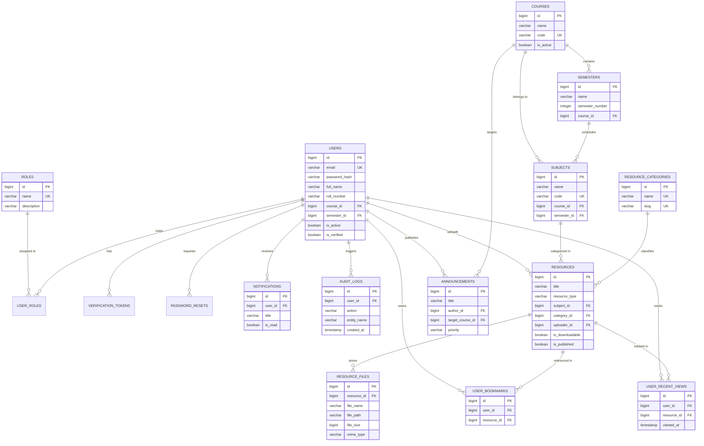

# Entity-Relationship (ER) Diagram: StudyMate

## 1. Visual Entity-Relationship Model

The following diagram illustrates the relational structure, primary keys, foreign keys, and cardinalities across the StudyMate persistence model.

---

## 2. Cardinality & Relational Semantics

### Many-to-Many Relationships
1. **Users and Roles (`users` ↔ `roles`)**:
   - Resolved via the junction table `user_roles(user_id, role_id)`.
   - A user may possess multiple roles (e.g., an Administrator who is also enrolled as a Student).
   - Deletion of a user or role cascades cleanly through `user_roles`.

2. **Resources and Tags (`resources` ↔ `tags`)**:
   - Resolved via `resource_tags(resource_id, tag_id)`.
   - Allows multi-dimensional tagging and discovery across departmental boundaries.

### One-to-Many Hierarchies
1. **Academic Hierarchy (`courses` → `semesters` → `subjects`)**:
   - Each course contains multiple semesters (typically 6-8).
   - Each semester and course pair hosts multiple subjects.
   - Deleting a course cascades to its semesters and associated subjects.

2. **Resource Ingestion (`subjects` / `resource_categories` → `resources` → `resource_files`)**:
   - Each subject and category classifies multiple resources.
   - Each resource has one or more binary files (`resource_files`).

3. **Student Activity Logs (`users` → `user_bookmarks`, `user_recent_views`)**:
   - Personalization data is isolated per student.
   - If a resource is deleted, bookmarks and recent views pointing to it are cascaded automatically.

